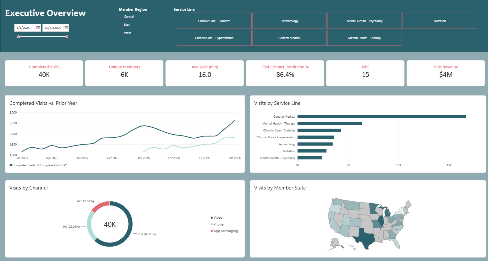
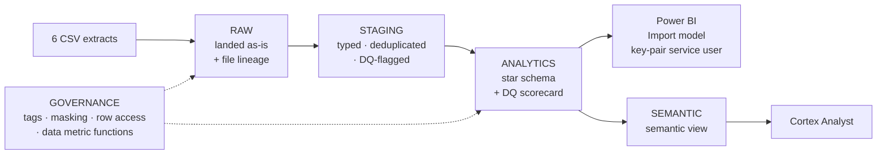
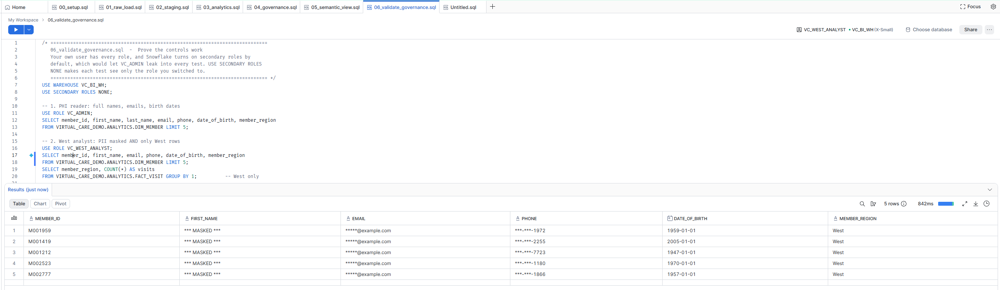
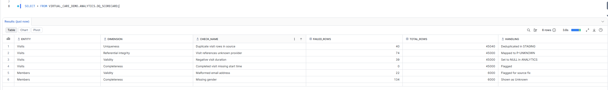

# Virtual Care Analytics: Snowflake to Power BI

An end-to-end, governed healthcare analytics platform, built from raw data to executive dashboard: layered ELT in Snowflake, masking and row-level security, data quality monitoring, a star-schema Power BI model, and a semantic view that readies the same data for conversational AI.

> **All data is synthetic.** *Cascade Virtual Care* is a fictional telehealth company. Every member, employer and provider is generated by [`scripts/generate_data.py`](scripts/generate_data.py) with a fixed seed. No real people or organizations are represented.



**Start here:** the [walkthrough notebook](notebooks/virtual_care_walkthrough.ipynb) tells the whole story in one place, from the planted data problems to a line-by-line reconciliation of every dashboard KPI against the raw files. There's also an 11-slide [visual walkthrough (PDF)](docs/project-walkthrough.pdf).

## What it demonstrates

| Area | What was built |
|---|---|
| **Snowflake architecture** | RAW → STAGING → ANALYTICS → SEMANTIC layers; separate ELT and BI warehouses; a resource monitor capping spend; numbered, rerunnable SQL scripts with a teardown |
| **Data engineering** | Load with file-level lineage; typing, deduplication and flagging in staging; a star schema with 2 fact tables and 5 conformed dimensions |
| **Data governance** | PII tags driving tag-based masking; row access by region from an entitlements table (deny by default); least-privilege role hierarchy; key-pair service account for BI |
| **Data quality** | Data Metric Functions plus a scorecard view; every planted issue is caught, handled and counted, never silently dropped |
| **Power BI** | Import semantic model with 10 single-direction relationships, a marked date table, and DAX measures for volume, access, quality, experience and time intelligence; executive dashboard |
| **AI readiness** | A Snowflake semantic view with business synonyms for Cortex Analyst, inheriting the same masking and row access |
| **Python** | Synthetic data generator with planted defects; a pandas notebook that profiles the data, mirrors the staging logic and reconciles the dashboard |

## Architecture



Design decisions are explained in [`docs/architecture.md`](docs/architecture.md).

## Highlights

- **Every dashboard number reconciles.** 45,040 source rows → 45,000 visits after removing 40 duplicates; completed visits, unique members, average wait (16.0 min), first-contact resolution (86.4%), NPS (15) and revenue are all recomputed from the raw files in the notebook and match the dashboard.
- **Governance travels with the data.** Signed in as a West-region analyst, the same query returns masked names, emails, phones and birth dates, and only West rows (13,379 of 45,000 visits). Power BI's service account sees the same masking, and personal-data columns are never imported into the model.
- **Insights in the data:** volume is up 44% year over year (Jan–Oct); behavioral health is 22% of visits but 34% of revenue; and members who wait more than 30 minutes give an NPS of −67, against +37 for those seen within 15 minutes.

| Governance in Snowflake (West analyst) | Data quality scorecard |
|---|---|
|  |  |

## Repository layout

```
data/                     synthetic source extracts (regenerate with scripts/generate_data.py)
scripts/generate_data.py  seeded data generator with planted data-quality defects
snowflake/                numbered SQL scripts, run in order (00–06); 99_teardown.sql resets
powerbi/                  DAX measures, model design, report page specs, theme
notebooks/                end-to-end walkthrough notebook (outputs included)
docs/                     architecture, build guide, screenshots, PDF walkthrough
```

## Run it yourself

1. **Snowflake:** start a free trial (Enterprise edition), then run `snowflake/00_setup.sql`, upload `data/*.csv` to the `RAW.LANDING` stage, and run `01` through `06` in order.
2. **Power BI:** connect Power BI Desktop to Snowflake with the `PBI_SVC` key-pair user, load the `ANALYTICS` tables, paste `powerbi/measures.dax` into DAX query view, and build the pages in `powerbi/report-pages.md`.
3. **Notebook:** `pip install pandas matplotlib`, then open `notebooks/virtual_care_walkthrough.ipynb`. It reads only the CSVs, so it runs without Snowflake.

Step-by-step instructions are in [`docs/build-guide.md`](docs/build-guide.md).

## Tools

Snowflake (Snowsight, tags, masking and row access policies, Data Metric Functions, semantic views) · Power BI Desktop (DAX, Power Query) · Python (pandas, matplotlib) · Git · AI-assisted development with Claude Code

---

Built by **Brandy Murray**.
