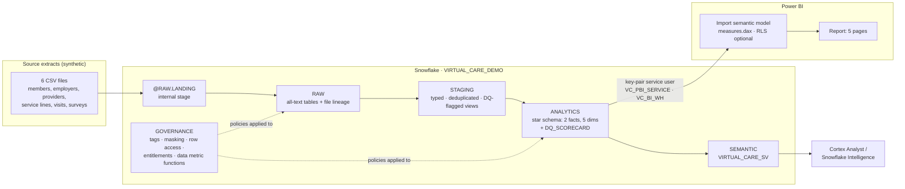
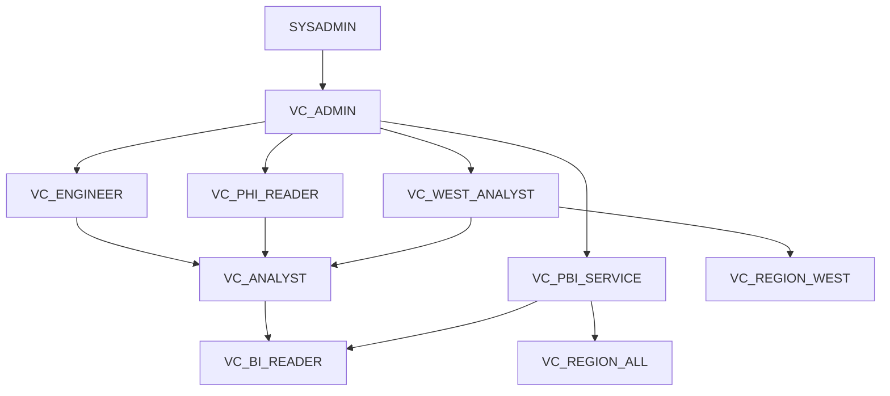

# Architecture

## Design decisions

| Decision | Why |
|---|---|
| RAW stores everything as text | A bad value never fails a load; it's flagged in STAGING instead, so nothing is lost silently |
| STAGING is views, ANALYTICS is tables | Staging always reflects the latest load; BI reads pre-built tables for speed and predictable cost |
| Flag, don't drop | Duplicates are deduplicated, orphan keys map to `P-UNKNOWN`, impossible values become NULL, and every case is counted in `DQ_SCORECARD` |
| Tag-based masking | Policy follows the classification. Tag a column and it's protected; no per-column policy sprawl |
| Entitlements in a table | Row access changes are data changes (INSERT), reviewable and auditable, not code changes |
| Deny by default | A role with no region entitlement sees zero rows |
| PII never imported to Power BI | The strongest control is not moving the data at all |
| Separate ELT and BI warehouses + resource monitor | Workload isolation and cost visibility per consumer |
| Key-pair service user | Snowflake is retiring password-only sign-in; Entra SSO is the per-user alternative |
| One KPI definition in two places (semantic view + DAX) | Called out explicitly so the team decides early where metric definitions are owned |

## Role hierarchy

`VC_PHI_READER` sees unmasked PII. Region roles (`VC_REGION_*`) carry row entitlements only; they grant no object access on their own.
